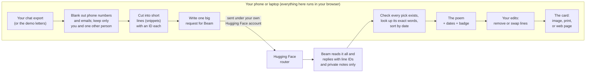

# Receipts

**A poem for someone you love, made only from things the two of you actually said to each other. Every line comes with its date, so they get the receipts.**

Built for the [Build with Beam](https://huggingface.co/reflection/Beam-1.0-501B-A23B/discussions/5) hackathon.

- **Try it:** [huggingface.co/spaces/Srini410/receipts](https://huggingface.co/spaces/Srini410/receipts)
- **The experiment behind it:** [huggingface.co/datasets/Srini410/receipts-eval](https://huggingface.co/datasets/Srini410/receipts-eval)

## What it is

You give Receipts a chat between you and one other person. It picks 6 to 14 of your real messages and puts them in date order as a short poem. Under every line it shows who said it and when, like a receipt. The result is a card you can save as an image, print, or send as a web page.

Not a single word is written by the AI. Every line is copied exactly from a message one of you really sent.

## Why

It's 11pm, the card is still blank, and the usual options are quote sites and chatbots. They produce words that sound like a greeting card, and the person receiving it can tell nobody lived them.

What proves you remember a shared life is the life itself. Your own messages are better than any new words, and the dates show they're real.

## How it works

1. **Pick a conversation.** Upload a WhatsApp chat export (Android or iPhone, `.txt` or `.zip`), or use the built-in demo: the 1845–1846 love letters between Robert Browning and Elizabeth Barrett.
2. **Say who is who.** Choose which person is you, who the poem is for, and the occasion: birthday, anniversary, thank you, sorry, missing you or farewell.
3. **Private details are removed on your device.** Phone numbers and email addresses are blanked out. In a group chat, only the two people you chose are used. Nobody else's messages are ever sent anywhere.
4. **Beam reads everything at once.** [Beam](https://huggingface.co/reflection/Beam-1.0-501B-A23B) is an AI model that can read a very long text in one go, so it sees your whole history rather than a small slice. It chooses the most telling moments across the years. It doesn't write anything. It only says which numbered lines it picked, and leaves a private note on each saying why.
5. **The app checks its work.** Each picked line is looked up in your original chat. Lines that don't exist are thrown out, the rest are sorted by date, and only a poem where every line checks out gets the "every line is real" badge.
6. **You stay in charge.** Read Beam's private notes, tap a line to see the real conversation around it, remove a line, swap it for another from the same period, or start over. You can't reword a line or reorder them, which is what keeps the badge honest.
7. **Make the card.** Add your own title if you like, then save it as an image, print it, or download a web page where tapping a line shows the original message with two messages either side. The rest of your chat is never included.

## The big picture



There is no Receipts server. Your chat goes from your browser to Beam through Hugging Face, using your own Hugging Face login, and nowhere else. We never see it or store it.

## Try it

- **Just look:** open the [Space](https://huggingface.co/spaces/Srini410/receipts). Without signing in you can already see six finished poems made from the demo letters, one per occasion.
- **Make your own:** sign in with Hugging Face, pick an occasion and tap **Make my Gallery Poem**, or upload your own WhatsApp export first. The app tells you how many messages it will read before it sends anything.

Anyone can upload their own export. Making a poem needs a Hugging Face account with a little credit on it, because the AI work is billed to your account, not ours. A poem costs about $0.15, and up to about $0.25 for a very long chat. A new free account may have no credit until you add some.

## Getting started

You need a phone or laptop, a free [Hugging Face](https://huggingface.co/join) account, and a little credit on that account (a poem costs about $0.15 to $0.25).

**1. Look first (no sign-in).** Open [huggingface.co/spaces/Srini410/receipts](https://huggingface.co/spaces/Srini410/receipts). You'll see six finished poems made from the demo letters, one for each occasion. Tap a line to see the original letter around it.

**2. Sign in.** Tap **Sign in with Hugging Face** and approve the request on the Hugging Face page. You never type an API key.

**3. Make a poem from the demo letters.** Choose an occasion, add a note for Beam if you like ("she just retired"), and tap **Make my Gallery Poem**. A progress bar shows while Beam reads. It usually takes under a minute. If you see an error, tap the retry button.

**4. Or use your own WhatsApp chat.**
1. In WhatsApp, open a chat with one other person, then export it **without media**. Android: ⋮ menu, **More**, **Export chat**. iPhone: tap the person's name, then **Export Chat**. Save it to your phone's Files. You get a `.txt` (Android) or `.zip` (iPhone). Use the `.zip` as it is.
2. In Receipts, tap **Use my own WhatsApp chat instead**, then **Choose your chat file**.
3. Under **Who is who?**, choose which person is you and who the poem is for.
4. If asked "6 March or 3 June?", pick the right date. This only appears when the export can't tell.
5. Check the message count and the privacy note, then tap **Continue**. Pick an occasion and tap the make button, which reads "Make the Poem for" and the name you chose.

**5. Read your poem.** Lines appear one by one, each with who said it and when. When every line has been checked against the original chat, the "every line is real" badge appears.

**6. Make it yours.** Beam's private notes explain why each line was chosen. Tap a line to see the real messages around it. **Remove** a line or **Replace** it with another from the same time, or **Regenerate the Poem** for a fresh take. You can't reword a line or change the order. A poem keeps at least 6 lines.

**7. Make the card.** Under **Make it a Card**, add a title if you want one (it's your words, Beam writes nothing). Then tap **Share the image** or **Save the image** (on a laptop, **Save as an image (PNG)**), **Print**, or **Download the Card (HTML)** for the web page version where each line opens to its original message. Beam's notes are never included.

**8. Clean up.** Delete the exported chat file from your phone when you're done. It holds your whole conversation.

## What to expect

- **A minute or less.** A progress bar shows while Beam reads. A successful run usually finishes in under a minute.
- **Sometimes it needs a second try.** On the long demo letters, between 1 in 3 and 1 in 2 attempts failed in our tests, and a retry usually fixed it. Beam can run out of thinking room, or hand back the wrong number of lines. Shorter chats should fail less often. You'll see a clear message and a retry button.
- **Very long chats are sampled.** If your chat is too big to read in one go, Beam reads evenly spread days across the whole timeline, and the app tells you how many it skipped.
- **Very short chats are refused.** With fewer than 15 usable lines you'll see "Not enough here yet for a Poem" instead of something padded.
- **Works best in English.** Beam was built mainly for English; its model card says so and doesn't mention Telugu or other Indian languages. In a first test on a small chat that mixed Telugu and English, the poem came out weak. Chats in other languages, mixed languages, or one language typed in another's letters are likely to give weaker picks and private notes. Small chats also give a small pool to choose from.
- **Tested mostly on made-up chats.** The upload feature was built and tested with invented examples, plus one small real chat. Real exports vary, so if yours fails, that's a bug worth reporting.

## Does reading everything actually help?

We ran a small experiment: 60 poems from the demo letters, either from Beam reading everything, Beam reading only the last 10%, or random lines with no AI. The full results are in the [dataset](https://huggingface.co/datasets/Srini410/receipts-eval). The honest summary:

- Every line Beam picked was real in the poems that finished. Reading only the last 10% covers just that last slice of the timeline, as you'd expect.
- Reading everything did **not** clearly spread the poem across the timeline better than random lines did (about 54–64% against 56%).
- Reading everything did pick a fairer mix of the two writers (a balance score of about 0.7 against 0.46 for random lines).
- Only the lowest "thinking" setting finishes on an input this large. Higher settings use up their room thinking and never answer (this comes from an earlier prototype, not rerun in this experiment).

## Credits

The demo letters are public-domain texts from Project Gutenberg ([16182](https://www.gutenberg.org/ebooks/16182) and [73891](https://www.gutenberg.org/ebooks/73891)). The words of every poem belong to the people who wrote them.

---

## For developers

Everything below is for people working on the code. Vocabulary is in [GLOSSARY.md](GLOSSARY.md); decisions are in [docs/adr/](docs/adr/).

## Develop

```
npm install
npm test            # Vitest: the Poem pipeline at its seam, plus the Beam adapter's edge
npm run typecheck   # strict TypeScript for src/ + tests/, and for scripts/
npm run dev         # Vite dev server: the real app, signed in with your local HF token
npm run build       # static site into dist/, including the Gallery texts and the Space README
npm run deploy:space  # build, check, and upload dist/ to the Space (needs HF_WRITE_TOKEN)
```

## The Space UI

`src/main.ts` only mounts the app. The flow is plain TypeScript with no DOM in `src/app/` (`state.ts`, `app.ts`, plus the pure `failure.ts`, `progress.ts`, `reveal.ts`), and the screens are in `src/ui/`: one module per step in `src/ui/steps/`, wired by the registry in `src/ui/steps/index.ts`. No UI framework.

Extension points for later features:

- **A new step**: add its id to `StepId` and its state/actions in `src/app/state.ts`, a module in `src/ui/steps/`, and one entry in the registry (`src/ui/steps/index.ts`).
- **Slots into existing screens** (`src/ui/extensions.ts`): `composeSections`, `composeNotices`, `lineActions`, `lineDetails`, `poemActions`. A feature is one module in `src/ui/features/` that pushes its slots and is listed in `src/ui/features/index.ts`.
- **The Poem view** (`src/ui/components/poem-view.ts`) renders Lines with Receipts and the badge, takes its own `slots`, and has `setPoem()` and `reveal()`; reuse it wherever a Poem is shown.
- **Failures**: `describeFailure()` in `src/app/failure.ts` turns any error into a message and a recovery; add a case there.

## The Card

`src/card/` turns a Poem into a Card; `src/ui/features/card-export.ts` is the panel under the Poem (a title the Giver writes, then three exports). Both exports are drawn from one `cardContent(poem, conversation, { title })` (`src/card/content.ts`), which has no field for a Note, so a Note cannot reach either of them.

- **HTML Card**: `renderCardHtml(poem, conversation, { title })` is a pure function to one self-contained document: inline CSS, no script (each Line expands to its Message plus two either side with a native `<details>`), a Content-Security-Policy that forbids any request, all text escaped, and a print stylesheet that gives one clean Card without the context.
- **PNG**: `drawCard(content, makeSurface)` draws 1080 px wide with Canvas 2D and system fonts; `src/card/deliver.ts` downloads it, or opens the share sheet on a phone. It is made ahead so the share sheet can open straight from the tap.
- **Print** puts the HTML Card in a hidden frame and prints that, so the Space around it is never printed.

## Running locally

OAuth cannot complete on localhost, so `npm run dev` serves your own Hugging Face token to the page (`scripts/vite-dev-token.ts`, serve-only: it is not in the build, and `npm run deploy:space` refuses to upload a build that contains it). It reads `HF_TOKEN` or `~/.cache/huggingface/token`. A real run costs credits, so for screen work use the scripted Beam (dev only, `src/dev/beam.ts`):

```
?beam=fake         # a Poem in about 8 seconds
?beam=unverified   # a Poem with a made-up pick: no badge
?beam=credits      # out of credits (HTTP 402), then a retry works
?beam=network      # dropped connection, then a retry works
?beam=truncated    # Beam ran out of room, then a retry works
?beam=expired      # sign-in refused (HTTP 401)
?beam=slow         # never finishes: the "taking longer" state
?beam=replace-fails  # the Poem works; the first Replace fails, then works
```

## Deploying the Space

`public/README.md` becomes the Space's README (its front-matter sets `sdk: static`, `hf_oauth: true` with the `inference-api` scope, and the Beam model tags), and the Vite `base` is `./` so the build runs from any Space path. `HF_WRITE_TOKEN=hf_... npm run deploy:space` builds, checks `dist/`, creates `Srini410/receipts` if needed and uploads the contents of `dist/` as one commit; `npm run deploy:space -- --dry` does everything but upload and needs no token. The token must be able to write repos in the `Srini410` namespace (the inference-only token cannot) and is never printed. After the first deploy, check sign-in on a phone, both inside the Space page and at the direct `https://srini410-receipts.static.hf.space` URL.

## The Poem pipeline

`src/` is a pure TypeScript library with no Node-only APIs, so the same code runs in the Vitest/Node scripts and in the browser. `makePoem(request, beam, { onProgress })` in `src/pipeline.ts` goes: raw source text -> Conversation (`src/sources/`) -> Snippets (`src/snippets.ts`) -> grouped prompt (`src/prompt.ts`) -> the **Beam port** (`src/beam/port.ts`) -> verified, date-sorted Poem (`src/verification.ts`). Everything else imports from `src/index.ts`.

- The Beam port is the only seam to the outside world. `createHfBeam` (`src/beam/hf.ts`) is the real adapter (HF router, streaming, `reasoning_effort: "low"`, `max_completion_tokens: 60000`, strict `json_schema`); `createFakeBeam` (`src/beam/fake.ts`) is a scriptable stand-in for tests and local work.
- Truncation, malformed answers, HTTP and network failures reject with a `BeamError` carrying `reason` and `retryable`.
- Beam only ever returns Snippet IDs and Notes ([ADR-0002](docs/adr/0002-beam-picks-snippet-ids-code-owns-order-and-text.md)); the Poem's text, Receipts and order come from the Conversation.

## Working with the Poem

After the reveal the Giver can remove a Line, replace one, or regenerate the Poem; there is deliberately no way to edit a Line's text or move a Line. A Poem is 6 to 14 Lines (the Glossary), so Remove stops at 6: the control is switched off with "A Poem needs at least 6 Lines." (`removalBlockedReason()`), while Replace keeps the count and always works. The logic is pure and lives in `src/editing.ts`: `removeLine`, and `replaceLine`, which makes **one** Beam call, shows Beam only the Snippets between the Line's neighbours (minus the current and removed ones, and only the Giver's and Recipient's), asks for a strict `{ "id": ... }`, and verifies the answer like any pick (it exists, lies in that period, is neither current nor removed). `src/context.ts` finds a Line inside its original Message and turns the verified callback IDs in a Note into links. `app.removeLine`, `app.replaceLine` and `app.regenerate` (which reruns the pipeline with the same choices) drive them. The screen is one feature module, `src/ui/features/notes-and-edit.ts`; everything in it is Giver-only (class `giver-only`, hidden when printing) and nothing the Card is built from reads it.

## Long and small Conversations

`src/selection.ts` decides what Beam reads and how many Lines it is asked for, between the Snippets and the prompt:

- **Budget**: the prompt is held to about 800k estimated input tokens (`INPUT_TOKEN_BUDGET`). A longer Conversation is read every 2nd (or 3rd, ...) *day*, whole days only, with the smallest stride that fits and the leftover at both ends split evenly, so the early years count as much as the late ones. `PoemOutcome.readFraction` carries the stride, the days read and the stretch covered; `readFractionMessage()` (`src/app/read-fraction.ts`) turns it into "Beam read every 2nd day across the 9 years." under the Poem (`src/ui/features/budget-messages.ts`).
- **Token estimate**: ASCII at 3 characters per token, anything else at one token per UTF-16 code unit. The Gallery's 1,245,565-character prompt was billed at 352,297 tokens (3.54 characters per token), so the estimate over-counts it by about 19% on purpose: a wrong guess should cost a few days, not a failed call.
- **Size table**: 40 or more usable Snippets ask Beam for 8 to 14 Lines, 15 to 39 for 6 to 8, and below 15 `tryMakePoem()` returns `{ refused: 'not-enough' }` without calling Beam. The app shows it as "Not enough here yet for a Poem" (`describeNotEnough()` in `src/app/failure.ts`). `makePoem()` is the same pipeline for callers that know the Conversation is big enough: it throws `NotEnoughError` instead.
- **Held to the table**: the range is not only in the prompt. After verification, the number of verified Lines must be inside the Conversation's range (never outside the Glossary's 6 to 14), or the pipeline throws a retryable `BeamError` with reason `wrong-size` ("Beam returned 5 Lines; a Poem needs 8 to 14. Try again.") and no Poem is shown; the failure screen offers the retry. Unknown IDs that verification drops count against the total, so 14 picks with 3 unknown IDs are judged as 11 Lines. The eval treats it like any other retryable failure: retried, and a Poem that never comes back the right size is a failed Poem in its group.

## Bringing a WhatsApp chat

`{ kind: 'whatsapp', file, dateOrder? }` is a `RawSource` like the Gallery's. `file` is the export's text, or the bytes of its `.txt` or `.zip` (`src/sources/export-file.ts` opens the zip with `fflate`, unpacking only its `.txt`). `src/sources/whatsapp.ts` reads Android (`31/12/2023, 21:41 - Mom: ...`) and iOS (`[31/12/2023, 21:41:05] Mom: ...`) lines, in 12h or 24h, with U+200E and U+202F tolerated, and a line that does not start with a timestamp continues the Message before it.

- **Never Snippets**: media placeholders, system messages, deleted messages and the "edited" marker (stripped from the text it trails) are dropped by the parser, so nothing after it can see them.
- **Day or month first**: any date component over 12 settles it. When none does, `inferDateOrder()` returns `null`, `dateQuestion()` picks one Message to show ("3 June 2024 or 6 March 2024?"), and the Giver's answer comes back as `dateOrder`. With no answer the pipeline throws `AmbiguousDatesError` instead of guessing.
- **Two voices only**: `between()` (`src/sources/between.ts`) keeps just the Giver's and the Recipient's Messages, before the token budget and the size table (`src/selection.ts`) look at anything, so a group's other members are never counted or sent.
- **Redaction** (`src/redaction.ts`) replaces phone numbers and email addresses with `[phone number]` and `[email address]` in every Message, before any Snippet is formed. Phone numbers are matched by shape (a `+` and 7 to 15 digits, two or three digit groups including `(555)123-4567`, seven or eight digits in two groups such as `8123 4567`, or nine or more digits in a row) and err towards removal; dates, years, times and plain figures are left alone. A Sender whose name is a number is redacted in the prompt too, and prompt labels are unique even when two names start with the same letter (`S1`, `S2`). The Poem's Receipts and Card keep the Sender's real name.
- **The steps** (`src/app/upload.ts` holds their state, `src/ui/steps/{upload,people,date-order,review}.ts` their screens): choose a file, which one is you and who it is for, the date question (only when it is real), then the count ("4,812 Messages from Mom and you") and the privacy statement, then the usual Occasion step. The parsed chat lives in `createApp`'s closure, not in the state, and is forgotten on sign-out. The Occasion step shows the source through the `composeSections` slot (`src/ui/features/upload.ts`).
- The Poem carries its Recipient (`poem.recipient`), and the Poem view says "For <Recipient>".

For manual tests with a real export, put it in the gitignored `.scratch/`. Fixtures in `tests/fixtures/whatsapp.ts` are synthetic.

## The Gallery texts

The Gallery is the Browning-Barrett letters, Project Gutenberg ebooks [16182](https://www.gutenberg.org/ebooks/16182) and [73891](https://www.gutenberg.org/ebooks/73891) (public domain). Both are **committed** as-is in `public/gallery/` (about 2.3 MB, under 1 MB compressed), so the static build serves them at `gallery/pg16182.txt` and `gallery/pg73891.txt` (`GALLERY_TEXT_PATHS`) and nothing has to be fetched at build time. `npm run gallery:fetch` re-downloads them if you ever need to refresh them. `public/gallery/*.txt` is marked `-text` in `.gitattributes` so git leaves their CRLF line endings alone.

## Live smoke test

`npm run smoke` makes one real Gallery Poem through Beam (about $0.15, up to about $0.25, of Hugging Face credits), reading the token from `~/.cache/huggingface/token`. The token only goes into the request's `Authorization` header and is never printed. `npm run smoke -- --dry` sizes the prompt without a token or any network. Real chats for manual testing go in the gitignored `.scratch/`.

## The eval: does reading everything help?

`eval/` measures it on the Gallery with three groups of Poems, 20 planned in each: Beam on the **full** Conversation, Beam on only the **last 10%** of Messages, and **random** Snippets (no Beam call), scored by verification rate, timeline coverage, Sender balance and Note callback count. Every Beam Poem goes through the same `makePoem` as the app (the last-10% group uses its `narrow` option). The metrics are defined in `eval/lib/metrics.ts`; the results, method and the finding that only `low` reasoning effort completes on 500k-token inputs are in the dataset card, `eval/dataset/README.md`. The committed dataset is the second run (after the prompt fix and the Poem-length rule); all 60 Poems are there (a $5 cap stopped the full-Conversation group at 18 of 20, and a second sitting with a higher cap made the last two); 3 full-Conversation Poems failed after all retries and are counted as failed, and the card says so.

```
npm run eval -- --per-group 1    # dry run: 1 Poem per group (about $0.30)
npm run eval                     # all 60 Poems (about $5.8 at the second run's rates); finished Poems are skipped, so it resumes
npm run eval -- --groups random,last10 --cap 5   # only some groups, in this order, under a stricter cap
npm run eval:report              # rebuild eval/dataset from the traces (no Beam, no token)
HF_WRITE_TOKEN=<token> npm run eval:publish   # upload eval/dataset as Srini410/receipts-eval
```

- Beam Poems cost real Hugging Face credits. Spend is counted from the usage Beam reports (router prices: $0.40/M in, $1.20/M out) and the run stops before any call that could pass a hard cap of $8 (`--cap` lowers it).
- Retryable Beam errors are retried at most twice per Poem; a Poem that still fails is kept as a failed trace and counted against its group. `--redo-failed` makes those Poems again.
- The inference token is read from `HF_TOKEN` or `~/.cache/huggingface/token`, goes only into the request's `Authorization` header, and is never printed or written; the run refuses to finish if it finds the token in `eval/dataset/`.
- `eval:publish` needs a separate token with write access to the dataset repo (the inference token cannot write repos), passed as `HF_WRITE_TOKEN`.
- Eval tests are in `eval/tests/` and use the fake Beam port, so `npm test` costs nothing.
